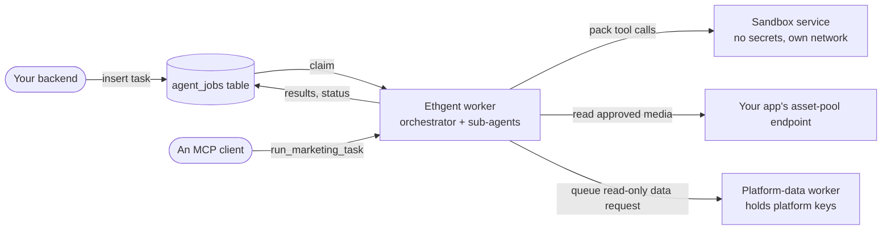

# Running Ethgent inside your backend

This guide is for a team that wants the agent to run next to its own services, take tasks from them, and act on its system within limits the team sets. It covers what to run, how a task gets in and a result gets out, who approves what, where each secret lives, and what is not solved yet.

The terminal app ([README](../README.md)) is the same agent with a person at the keyboard. Nothing here changes it.

## What you run



| Piece | What it is | Required |
|---|---|---|
| **Worker** (`python -m MarketingApp.worker`, the [`Dockerfile`](../Dockerfile)) | One process: polls the queue and serves MCP on port 8091. Both entry points share one agent and never run two tasks at once. | yes |
| **Queue table** (`agent_jobs`, [`migrations/`](../migrations)) | Postgres table read through Supabase's REST API. Tasks go in, results come back, every run leaves a row. | for the queue; MCP works without it |
| **Sandbox service** (`python -m MarketingApp.sandbox.service`, same image) | Runs the tools of installed packs, outside the worker. | if you install packs |
| **Connection workers and contracts** ([Marketing Agent Assets](https://github.com/Ahmet2001/MarketingPool/tree/main/marketing-agent-assets)) | The `asset-pool` contract your app implements, the platform-data worker, the publishing worker. | only for the sub-agents that use them |

[MarketingPool](https://github.com/Ahmet2001/MarketingPool) runs all of these with Docker Compose on one machine, with a local Postgres + PostgREST standing in for Supabase. It is the most complete example; this guide explains the parts so you can put them into your own setup.

## 1. Create the queue table

Run [`migrations/001_agent_jobs.sql`](../migrations/001_agent_jobs.sql) and [`002_agent_jobs_idempotency_key.sql`](../migrations/002_agent_jobs_idempotency_key.sql) on your database. The table has `status` (`queued`, `processing`, `done`, `failed`), `payload`, `results` and `error`. `claim_next_agent_job()` takes the oldest queued row with `for update skip locked`, so several workers can poll one table without taking the same job.

The worker authenticates with `SUPABASE_AGENT_KEY` if it is set and falls back to `SUPABASE_SECRET_KEY` (the service-role key, which can read and write every table) with a warning. Give it the narrow key: `002_*.sql` contains a commented role, `marketing_agent_writer`, with `select, insert, update` on `agent_jobs` and nothing else. Create it, make an API key for it, and put that key in `SUPABASE_AGENT_KEY`.

## 2. Configure and start the worker

All settings are in [`.env.example`](../.env.example). The ones that matter here:

| Variable | Meaning |
|---|---|
| `MODEL_PROVIDER`, the provider's key, `BASE_MODEL_NAME`, `SUBMODEL_MODEL_NAME` | The model. Any OpenAI-compatible API. |
| `SUPABASE_URL`, `SUPABASE_AGENT_KEY` | The queue. Without them the worker does not poll; MCP still works. |
| `AGENT_WORKER_MCP_TOKEN` | Bearer token for MCP. Without it every MCP request is refused. |
| `AGENT_WORKER_POLL_MS` | How often the queue is polled (default 4000). |
| `ETHGENT_SANDBOX_URL`, `ETHGENT_SANDBOX_TOKEN` | Where pack tools run (step 5). |
| `AGENT_WORKER_MCP_APPROVABLE_TOOLS` | Tools an MCP caller may approve for its own call (step 4). Empty by default. |
| `AGENT_WORKER_HEARTBEAT_SECONDS`, `AGENT_WORKER_STALE_SECONDS`, `AGENT_WORKER_MAX_ATTEMPTS` | Recovery of jobs whose worker stopped (30, 300, 3; step 8). |
| `ETHGENT_TELEMETRY_EXPORT` | `stdout` or a file path: run history, events and token usage as JSON lines (step 8). |

A minimal Compose file next to your other services:

```yaml
services:
  ethgent:
    build: ./Ethgent                  # a checkout of this repository
    restart: unless-stopped
    shm_size: "1gb"                   # Chromium, for the browser tools
    env_file: ethgent.env             # model key, SUPABASE_URL, SUPABASE_AGENT_KEY, AGENT_WORKER_MCP_TOKEN
    environment:
      ETHGENT_SANDBOX_URL: http://ethgent-sandbox:8092
      ETHGENT_SANDBOX_TOKEN: ${SANDBOX_TOKEN}
    volumes:
      - ethgent-data:/data            # workspace, config, run history
      - pack-deps:/data/site-packages # packages that installed packs need
    networks: [default, sandbox]

  ethgent-sandbox:
    build: ./Ethgent
    command: ["python", "-m", "MarketingApp.sandbox.service"]
    restart: unless-stopped
    environment:
      HOME: /tmp
      ETHGENT_SANDBOX_TOKEN: ${SANDBOX_TOKEN}
    volumes:
      - pack-deps:/data/site-packages:ro
    read_only: true
    tmpfs: ["/tmp:size=256m"]
    cap_drop: [ALL]
    security_opt: ["no-new-privileges:true"]
    user: "65534:65534"
    mem_limit: 2g
    pids_limit: 256
    networks: [sandbox]               # not on the network your database is on

networks:
  sandbox:

volumes:
  ethgent-data:
  pack-deps:
```

Build with `docker compose build` (the Dockerfile needs BuildKit, which Compose uses). The worker is ready when its log shows `agent_jobs kuyrugu dinleniyor` and `MCP sunucusu`. Do not publish port 8091 beyond the services that need it.

## 3. Send a task and read the result

Insert a row; the worker claims it, runs it and writes the result back:

```sql
insert into agent_jobs (owner_ref, payload) values (
  'order-1234',
  '{"task": "Draft three X posts about this week''s release notes.",
    "context": "Release notes: ...",
    "approved_tools": []}'
) returning id;
```

Through the REST API this is a `POST /rest/v1/agent_jobs` with the same JSON. Poll the row (or subscribe to changes) until `status` is `done` or `failed`. `results` holds `text` (the final answer), `direct_texts` and `step_texts` (what was said along the way); `error` holds the reason for a failure.

`owner_ref` is yours: use it to tie a job to a user, an order or a tenant.

From an MCP client, call `run_marketing_task(task, context)` on `http://<worker>:8091/mcp` with `Authorization: Bearer <AGENT_WORKER_MCP_TOKEN>`. A task that takes longer than `AGENT_WORKER_WAIT_MS` (45 s) returns a job id; ask again with `check_marketing_task(job_id)`. MCP calls also leave a row in `agent_jobs` when the queue is configured.

To call the agent from your own Python code instead, use `EthgentAgent` ([README](../README.md#running-inside-your-backend)).

## 4. Decide what may change the outside world

No tool that changes something outside asks the model for permission. It asks the process's approval gate, and in the worker the gate approves a tool only if **the job that is running names it** in `approved_tools`. The model cannot add to that list, and neither can a task text: it comes from whoever can insert into `agent_jobs`.

```json
{"task": "Post the approved announcement on X.", "approved_tools": ["publish_x_post"]}
```

What asks:

- **The agent's own social tools that act in public:** posting, replying, quoting, reposting, liking, following, commenting, subscribing (the list is `BUILTIN_EXTERNAL_WRITE_TOOLS` in [`approval_runtime.py`](../MarketingApp/environments/approval_runtime.py)).
- **Publishing through the publishing worker** (`worker_video_yayinla`, `worker_instagram_carousel_yayinla`) and asking your app to generate a video (`video_uretimi_iste`).
- **Any pack tool declared `requires_approval: true`**, including every workflow from the factory that writes outside.

What does not ask: tools that only read, prepare a draft or keep something private, and the general browser and terminal tools (`browser_click_*`, `terminal_komut_calistir`). Those can do anything, so do not give them to a sub-agent that runs unattended unless you accept that. Sub-agents are switched on and off in `config/agents.yaml` (`/agent <name> off` at a terminal).

A refused call returns `[Onay yok]: <tool> onaylanmadi, calistirilmadi.` to the model and nothing runs.

Over MCP, `run_marketing_task` takes `approved_tools` too, but only tools you list in `AGENT_WORKER_MCP_APPROVABLE_TOOLS` are granted; the rest are ignored. The list is empty by default, so an MCP call approves nothing unless you decide otherwise. Keep it short: an MCP client is often itself a model, and whatever you list there it can approve. With `EthgentAgent` you pass `approval_handler=`, an async function `(action_id, description) -> bool`; without it everything gated is refused.

## 5. Install packs; their tools run in the sandbox

A pack (`plugin.yaml` with sub-agents and tools, for example one exported from the workflow factory) is installed into the worker's config:

```bash
docker compose exec ethgent pip install --target /data/site-packages -r /path/to/pack/requirements.txt   # if it has one
docker compose exec ethgent python -c "from MarketingApp.llms.agent_studio import install_agent_pack; install_agent_pack('/path/to/pack')"
docker compose restart ethgent
```

The sub-agent runs in the worker; each call to one of the pack's tools is sent to the sandbox service. There the tool runs as a subprocess with a time and memory limit and sees only its own file, the environment variables it declared, and the packages in `pack-deps`. Variables the agent itself uses (model keys, `SUPABASE_*`, chat tokens, …) are never passed, even if declared. The tool cannot see the worker's files, and on its own network it cannot reach your database. In MarketingPool a probe tool saw exactly this; see the [sandbox section](../README.md#sandbox-for-installed-packs) for all settings.

If tools should read files you give the agent, mount that folder read-only into the sandbox and name the variable that points to it in `ETHGENT_SANDBOX_SHARED_ENV` (MarketingPool does this for `STUDIO_FILE_ROOTS`). A tool's own output files stay inside the sandbox and are discarded after the call, so ask for text outputs when the agent has to see the content.

`install_agent_pack(..., trusted=True)` runs a pack's tools in the worker instead, with everything the worker can reach. Use it only for code you wrote or reviewed; a pack that carries Python sub-agent code is refused without it.

## 6. Connect it to your application

Two sub-agents ship off and connect the agent to a system. Switch them on in `config/agents.yaml` (`enabled: true`) when the settings exist.

- **`asset_collector_agent`** reads the media your app has approved. Your app implements the `asset-pool` contract (`GET /api/assets`, `GET /api/assets/{id}`, bearer token; optionally video generation requests). Set `APP_INTERNAL_URL`, `APP_INTERNAL_TOKEN`. Signed URLs your app returns are masked before the model sees them; publishing tools resolve them by reference. Contract and a kit: [`asset-pool/`](https://github.com/Ahmet2001/MarketingPool/tree/main/marketing-agent-assets/asset-pool).
- **`platform_data_agent`** asks for read-only platform data (metrics, comments) by queueing a request for the platform-data worker, which holds the platform credentials and allows only the actions in its manifests. The agent checks requests against the same manifests (`TOOLBOXES_DIR`). Worker and manifests: [`platform_data_worker/`](https://github.com/Ahmet2001/MarketingPool/tree/main/marketing-agent-assets/platform_data_worker), [`toolboxes/`](https://github.com/Ahmet2001/MarketingPool/tree/main/marketing-agent-assets/toolboxes).

For your own domain, the same shape applies: a sub-agent with a prompt and a few tools that call your service, packaged as a pack. Nothing in the orchestrator changes.

## 7. Where each secret lives

| Secret | Held by | Never reaches |
|---|---|---|
| Model API key | the worker | sandboxed tools, the model's context |
| Queue key (`SUPABASE_AGENT_KEY`, narrowed to `agent_jobs`) | the worker | sandboxed tools |
| `AGENT_WORKER_MCP_TOKEN` | the worker and your MCP clients | sandboxed tools |
| `SANDBOX_TOKEN` | the worker and the sandbox service | sandboxed tools |
| App token (`APP_INTERNAL_TOKEN`) | the worker | sandboxed tools; signed media URLs are masked for the model |
| Platform credentials | the platform-data and publishing workers | the agent entirely |
| A pack tool's own key | the worker, passed only to that tool | other tools |

## 8. Operating it

- **Logs** go to stdout. Run history, tool calls and token usage are also kept in a SQLite file in the workspace (`/data/workspace/runtime/telemetry.sqlite`). Set `ETHGENT_TELEMETRY_EXPORT=stdout` (or a file path) to also get every record as one JSON line (`kind` is `run_start`, `run_end`, `event` or `llm_usage`, with `run_id`, `job_id`, tokens and status), which your log collector can read and turn into dashboards and alerts.
- **Scaling.** One worker runs one task at a time. For more throughput run more workers, each with **its own** workspace volume: two processes on one workspace (for example a worker and the terminal) do not coordinate. The queue's skip-locked claim keeps them from taking the same job.
- **Crashes.** While a job runs, its worker refreshes the row's `updated_at` every `AGENT_WORKER_HEARTBEAT_SECONDS`. Every minute, each worker looks for `processing` rows whose `updated_at` is older than `AGENT_WORKER_STALE_SECONDS`: a queued job goes back to `queued` (and is retried) until it has had `AGENT_WORKER_MAX_ATTEMPTS` attempts, then it is marked `failed`; a job that came over MCP is marked `failed`, since nobody waits for it any more. The update repeats the condition, so a worker that was only slow keeps its job. A retried job runs again from the start: a tool that already acted outside (a post, a payment) may act twice, which is one more reason to keep such tools behind approval.
- **Browser sessions.** The social tools drive a signed-in browser profile in the workspace. That is an interactive setup by nature; for unattended publishing prefer the publishing worker, which uses official APIs and holds its own credentials.

## What has and has not been run

Run: the worker in Docker with a local Postgres + PostgREST queue and a real model (DeepSeek), taking jobs from `agent_jobs`; a publish request without `approved_tools` refused at the gate; a connection sub-agent answering from the toolbox manifests; pack tools from the workflow factory running in the sandbox service (reading an inbox file, importing an installed package); a probe tool confirming what the sandbox hides. Before this repository had the worker, the same worker code ran inside a real application's backend (Kara Tahta) as a queue worker, limited by a database role to its own queue.

Recovery of stalled jobs was run against the local PostgREST queue (a stale job requeued, one at its attempt limit failed, an MCP job failed, a live one untouched).

Not run: a hosted Supabase project with the narrowed key, several workers on one queue, real publishing to a platform, real platform data, a team outside the authors integrating it.
